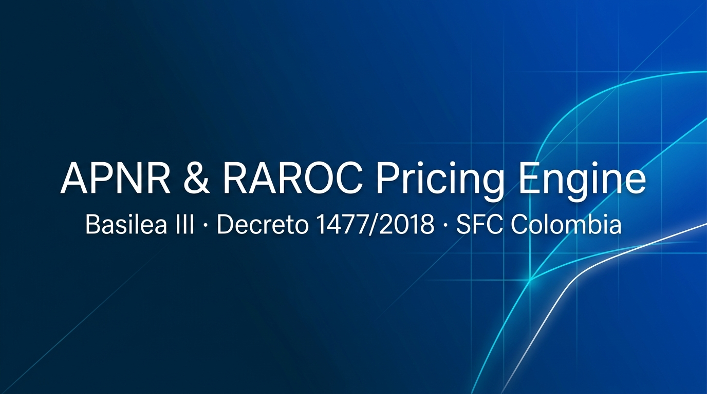
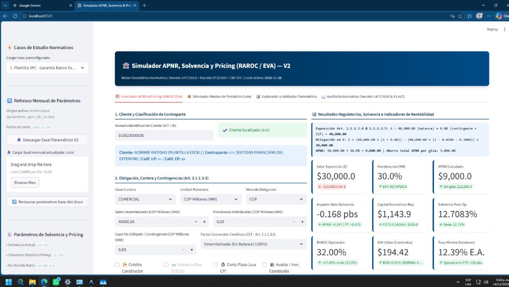
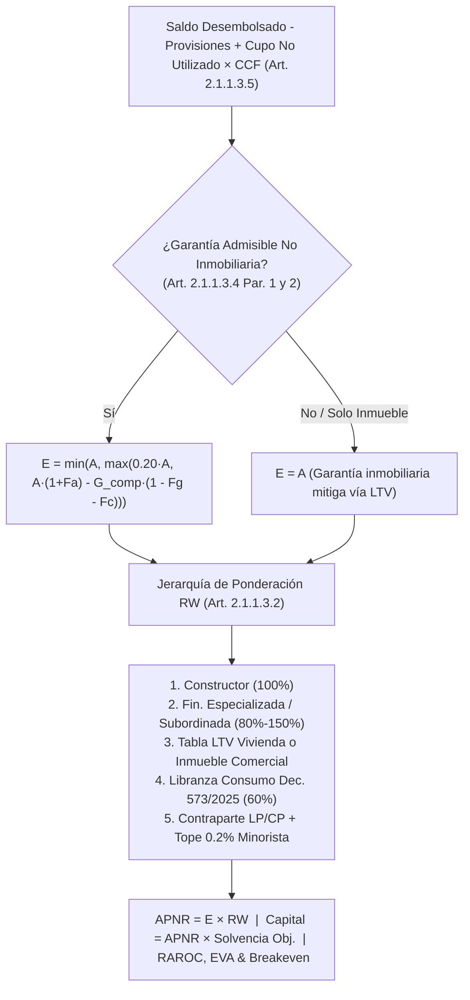

<div align="center">



# 🏦 Simulador APNR, Solvencia (pbs) & Pricing (RAROC / EVA) — V2

**Motor Paramétrico de Riesgo de Crédito y Rentabilidad Ajustada a Capital bajo Basilea III (Colombia)**

[](https://www.python.org/)
[](https://streamlit.io/)
[](https://docs.pytest.org/)
[](#marco-normativo-implementado)

</div>

---

## 📌 Descripción General

Aplicación interactiva desarrollada en **Python + Streamlit** para simular en tiempo real el impacto regulatorio en **Activos Ponderados por Nivel de Riesgo Crediticio (APNR)**, la **Relación de Solvencia (pbs)** y los indicadores de **Pricing y Rentabilidad (RAROC, EVA, ROA, RORWA y Tasa Mínima Breakeven)** de operaciones de crédito en originación.

El motor está parametrizado 100% desde un archivo Excel maestro (`parametros_apnr_sfc_v2.xlsx`) diseñado para ser **refrescado mensualmente** (tasas FTP, solvencia del banco, cartera minorista, base de clientes y tablas regulatorias) sin tocar el código fuente.

> **Nota de alcance:** Al tratarse de un simulador de originación y *pricing*, el flujo excluye operaciones en estado de incumplimiento.

---

## 🖥️ Vista Previa de la Aplicación



---

## ✨ Funcionalidades Principales

| Módulo | Capacidades Clave |
| :--- | :--- |
| **🧮 Simulador Individual (APNR & Pricing)** | Cálculo en vivo de Exposición ($E$), LTV, Ponderación ($RW$), APNR, Impacto Neto en Solvencia (pbs), Capital Económico / CET1, **RAROC**, **EVA**, **ROA**, **RORWA** y **Tasa Mínima Breakeven** (`RAROC = Ke`). |
| **📊 Gráficos Interactivos (Plotly)** | Cascada **P&L Anual** de la operación (Intereses, Comisiones, FTP + Liquidez, Pérdida Esperada, Gastos, Impuestos) y curva de **Sensibilidad Tasa Activa vs. RAROC**. |
| **📦 Simulador Masivo de Portafolio (Lote)** | Carga de plantillas `.xlsx` con múltiples operaciones para evaluar APNR agregado, RAROC ponderado del portafolio, EVA total e impacto consolidado en solvencia. |
| **🔄 Refresco Mensual Validado** | Carga de parámetros mensuales desde la barra lateral con **validación automática de esquema**, tipos de datos, unicidad de llaves y rangos numéricos en memoria (sin sobrescribir insumos originales). |
| **📥 Exportación Ejecutiva** | Descarga de la liquidación completa de APNR & Pricing, resultados de lote y plantilla paramétrica actualizada en formato `.xlsx`. |

---

## ⚖️ Marco Normativo Implementado

El motor implementa las reglas de riesgo de crédito del **Decreto 1477 de 2018** (compilado en el **Decreto 2555 de 2010**), el **Decreto 573 de 2025** y el **Capítulo 1 de la Parte 2 de la Circular Básica Financiera (CBF)** de la Superintendencia Financiera de Colombia (SFC):



### Detalles Técnicos Clave
- **Art. 2.1.1.3.4 (Valor de Exposición $E$):**
  - Piso normativo automático $0.20 \cdot A \le E \le A$ cuando aplican mitigantes no inmobiliarios.
  - **Parágrafos 1 y 2:** Las garantías inmobiliarias (`BRCR`, `BDLI`) no reducen $E$ (mitigan vía LTV); en garantías mixtas concurrentes, solo la porción admisible no inmobiliaria reduce $E$.
  - **Factor Cambiario ($F_c$):** Diferencia **`8%`** para colateral financiero admisible y **`30%`** para otras garantías idóneas ante descalce de monedas (`COP`, `USD`, `EUR`, `UVR`).
- **Art. 2.1.1.3.2 (Ponderaciones $RW$):**
  - Tablas **LTV** sin brechas numéricas usando intervalos semiabiertos $[\text{Lím. Inf}, \text{Lím. Sup})$.
  - Matriz completa de contrapartes (`AAA` hasta `D`, incluyendo `B+`, `B`, `B-`) y calificaciones de corto plazo (`Calificacion_CP`).
  - Control de concentración del **0.2% de la cartera minorista** para Pymes y Personas Naturales.
  - **Decreto 573 de 2025:** Ponderación preferencial parametrizable para cartera de consumo bajo modalidad **libranza**.
- **Art. 2.1.1.3.5 (Contingencias):** Factores de Conversión Crediticia (**CCF**) del `100%`, `50%` y `10%` para cupos no desembolsados y contingencias.

---

## 📁 Estructura del Repositorio

```text
├── 00_Calculo_APNR_V2.py           # Aplicación web principal en Streamlit
├── apnr_motor_v2.py                # Motor modular de cálculo, validación Excel y lote
├── test_apnr_motor_v2.py           # Suite de pruebas unitarias (pytest)
├── parametros_apnr_sfc_v2.xlsx     # Archivo maestro de parámetros (12 hojas, refresco mensual)
├── assets/
│   ├── banner_apnr_v2.jpg          # Banner del repositorio
│   └── simulador_apnr_v2.jpg       # Captura de pantalla de la aplicación
└── README.md
```

---

## 🚀 Ejecución Local

1. Clona el repositorio y ubica la terminal en la carpeta del proyecto:
   ```bash
   git clone https://github.com/edgarvarcarcel/<NOMBRE_DEL_REPO>.git
   cd <NOMBRE_DEL_REPO>
   ```

2. Asegúrate de contar con un entorno Python / Anaconda con `streamlit`, `pandas`, `numpy`, `openpyxl`, `plotly` y `pytest`.

3. Ejecuta la aplicación:
   ```bash
   streamlit run 00_Calculo_APNR_V2.py
   ```

4. *(Opcional)* Ejecuta la suite de pruebas unitarias para validar todas las reglas normativas y cálculos de *pricing*:
   ```bash
   pytest -v test_apnr_motor_v2.py
   ```

---

## 🔄 Cómo Realizar el Refresco Mensual

1. Descarga el archivo activo desde la barra lateral (**"📥 Descargar Excel Paramétrico V2"**) o edita una copia de `parametros_apnr_sfc_v2.xlsx`.
2. Actualiza en la hoja **`Metadata_Mensual`** los valores del mes (`Fecha_Corte`, `Solvencia_Total_Actual`, `Cartera_Minorista_Total_MM`, `FTP_Base_EA`, `Costo_Capital_Ke_EA`, `Tasa_Impuesto_Renta`, etc.) y, si aplica, la hoja **`Clientes`**.
3. Sube el archivo actualizado en el cargador de la barra lateral (**"📤 Cargar Excel mensual actualizado"**). La aplicación validará automáticamente todas las hojas y activará los nuevos parámetros al instante.

---

<div align="center">
Desarrollado por <a href="https://github.com/edgarvarcarcel"><b>Edgar Varcarcel</b></a> · Riesgo de Crédito, Solvencia & Pricing Bancario
</div>
